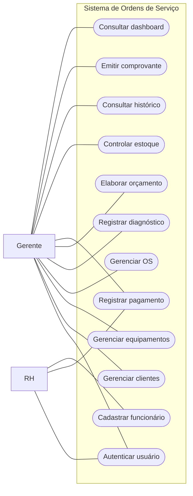

# 06 — Casos de Uso do Sistema

**Projeto:** Sistema de Ordens de Serviço para Assistência Técnica  
**Documento:** Especificação de Casos de Uso  
**Versão:** 1.0 — Modelagem inicial  
**Status:** Elaborado — aguardando revisão e aprovação

**Documentos de referência:**
- `01-visao-do-projeto.md`
- `02-levantamento-requisitos.md`
- `03-requisitos.md`
- `04-regras-de-negocio.md`
- `05-historias-usuario.md`

---

## 1. Objetivo

Este documento descreve os principais casos de uso do Sistema de Ordens de Serviço para Assistência Técnica.

Os casos de uso representam interações entre os atores e o sistema para atingir objetivos específicos.

Cada caso de uso poderá apresentar:

- Identificador.
- Nome.
- Atores envolvidos.
- Objetivo.
- Pré-condições.
- Gatilho.
- Fluxo principal.
- Fluxos alternativos.
- Exceções.
- Pós-condições.
- Referências aos requisitos, regras de negócio e histórias de usuário.

O objetivo é apoiar o entendimento dos processos, o desenvolvimento das funcionalidades e a elaboração dos testes.

---

## 2. Convenções

### 2.1 Identificadores

Os casos de uso utilizarão identificadores no formato:

`UC-001`, `UC-002`, `UC-003` etc.

UC significa *Use Case*.

### 2.2 Atores

Um ator representa um papel que interage com o sistema.

**Gerente:** responsável pelos atendimentos, clientes, equipamentos, ordens de serviço e atividades operacionais.

**RH:** responsável por atividades administrativas e pelo registro de pagamentos, conforme as permissões autorizadas.

**Cliente:** participante externo do processo de atendimento. Na primeira versão, não acessa diretamente o sistema.

**Técnico:** participante do processo de manutenção, sem perfil próprio de acesso confirmado na primeira versão.

### 2.3 Classificação

- **Definido:** fluxo principal sustentado pelas decisões confirmadas.
- **Parcialmente definido:** fluxo conhecido, mas com regras pendentes.
- **Proposto:** interação sugerida, ainda sujeita a aprovação.

Os fluxos alternativos apresentados como propostas não deverão ser considerados regras aprovadas.

---

# 3. Visão Geral dos Casos de Uso

| ID | Caso de uso | Ator principal | Estado |
|---|---|---|---|
| UC-001 | Autenticar usuário | Gerente / RH | Definido |
| UC-002 | Cadastrar cliente | Gerente | Definido |
| UC-003 | Localizar cliente existente | Gerente | Definido |
| UC-004 | Cadastrar equipamento | Gerente | Definido |
| UC-005 | Abrir ordem de serviço | Gerente | Definido |
| UC-006 | Atualizar andamento da OS | Gerente | Parcialmente definido |
| UC-007 | Registrar diagnóstico | Gerente | Definido |
| UC-008 | Elaborar orçamento | Gerente | Definido |
| UC-009 | Registrar decisão sobre orçamento | Gerente | Definido |
| UC-010 | Registrar pagamento integral | Gerente / RH | Definido |
| UC-011 | Encerrar ordem de serviço | Gerente | Definido |
| UC-012 | Cancelar ordem de serviço | Gerente | Parcialmente definido |
| UC-013 | Cadastrar e consultar peças | Gerente | Definido |
| UC-014 | Vincular peças à OS | Gerente | Definido |
| UC-015 | Devolver peça ao estoque | Gerente | Parcialmente definido |
| UC-016 | Consultar histórico do equipamento | Gerente | Definido |
| UC-017 | Anexar fotografias | Gerente | Parcialmente definido |
| UC-018 | Emitir comprovante em PDF | Gerente | Definido |
| UC-019 | Consultar dashboard | Gerente | Definido |
| UC-020 | Cadastrar funcionário | RH | Parcialmente definido |

---

# 4. UC-001 — Autenticar Usuário

**Ator principal:** Gerente ou RH  
**Objetivo:** permitir acesso autenticado às funcionalidades autorizadas.  
**Pré-condições:** usuário previamente cadastrado e habilitado.  
**Gatilho:** usuário solicita acesso ao sistema.  
**Estado:** Definido.

## Fluxo principal

1. O usuário acessa a tela de autenticação.
2. O sistema solicita suas credenciais.
3. O usuário informa as credenciais.
4. O sistema valida as informações.
5. O sistema identifica o perfil do usuário.
6. O sistema permite acesso às funcionalidades autorizadas.

## Fluxos alternativos

**A1 — Credenciais inválidas**

1. O sistema identifica falha na autenticação.
2. O sistema informa que não foi possível autenticar.
3. O acesso às funcionalidades internas permanece bloqueado.

**A2 — Usuário sem autorização para uma funcionalidade**

1. O usuário tenta acessar uma funcionalidade não autorizada.
2. O sistema verifica suas permissões.
3. O acesso é negado.

## Pós-condições

**Sucesso:** usuário autenticado e autorizado conforme seu perfil.

**Falha:** acesso não concedido.

**Referências:** RF-001, RF-002, RN-045, RN-046, US-001, US-002.

---

# 5. UC-002 — Cadastrar Cliente

**Ator principal:** Gerente  
**Objetivo:** registrar um novo cliente.  
**Pré-condições:** gerente autenticado e autorizado.  
**Gatilho:** gerente seleciona a opção de cadastro de cliente.  
**Estado:** Definido.

## Fluxo principal

1. O gerente acessa a área de clientes.
2. Seleciona a opção de novo cadastro.
3. O sistema apresenta o formulário.
4. O gerente informa os dados do cliente, incluindo telefone.
5. O gerente solicita o salvamento.
6. O sistema valida os campos obrigatórios.
7. O sistema registra o cliente.
8. O sistema confirma a operação.

## Fluxos alternativos

**A1 — Telefone não informado**

1. O gerente tenta salvar o cadastro sem telefone.
2. O sistema identifica a ausência do campo obrigatório.
3. O sistema impede o salvamento.
4. O sistema solicita o preenchimento do telefone.

**A2 — Possível cadastro duplicado**

*Fluxo proposto, sujeito a refinamento.*

1. O sistema identifica possível correspondência com um cadastro existente.
2. O sistema informa a situação ao gerente.
3. O gerente poderá consultar o cadastro encontrado.

## Pós-condições

**Sucesso:** cliente registrado e disponível para futuros atendimentos.

**Falha:** nenhum novo cadastro é concluído.

**Referências:** RF-004, RF-005, RN-001, RN-004, US-004.

---

# 6. UC-003 — Localizar Cliente Existente

**Ator principal:** Gerente  
**Objetivo:** localizar e reutilizar um cadastro existente.  
**Pré-condições:** gerente autenticado e cliente previamente cadastrado.  
**Gatilho:** gerente inicia uma pesquisa de cliente.  
**Estado:** Definido.

## Fluxo principal

1. O gerente acessa a pesquisa de clientes.
2. Informa o nome ou telefone.
3. O sistema consulta os cadastros.
4. O sistema apresenta os resultados encontrados.
5. O gerente seleciona o cliente desejado.
6. O sistema apresenta suas informações.
7. O gerente poderá utilizar o cadastro em uma nova OS.

## Fluxo alternativo

**A1 — Cliente não encontrado**

1. A pesquisa não retorna resultados.
2. O sistema informa que nenhum cliente foi encontrado.
3. O gerente poderá iniciar um novo cadastro.

## Pós-condições

Cliente existente localizado e disponível para reutilização.

**Referências:** RF-005, RF-006, RF-007, RN-002, US-005, US-006.

---

# 7. UC-004 — Cadastrar Equipamento

**Ator principal:** Gerente  
**Objetivo:** cadastrar individualmente um computador ou notebook.  
**Pré-condições:** gerente autenticado e cliente cadastrado.  
**Gatilho:** gerente solicita o cadastro de um equipamento.  
**Estado:** Definido.

## Fluxo principal

1. O gerente seleciona o cliente proprietário.
2. Solicita o cadastro de um equipamento.
3. O sistema apresenta o formulário.
4. O gerente informa o tipo, a marca, o modelo e as demais informações disponíveis.
5. O gerente informa o número de série de fábrica, quando existente.
6. O gerente solicita o salvamento.
7. O sistema gera um identificador interno único.
8. O sistema registra o equipamento vinculado ao cliente.
9. O sistema apresenta o identificador gerado.

## Fluxos alternativos

**A1 — Equipamento sem número de série geral de fábrica**

1. O gerente informa que o equipamento não possui número de série geral.
2. O sistema utiliza o código interno como identificação principal.
3. O equipamento é cadastrado normalmente.

**A2 — Identificador interno já utilizado**

1. O sistema identifica conflito de unicidade.
2. O sistema impede a atribuição de um código duplicado.
3. A operação deverá utilizar outro identificador válido.

## Pós-condições

Equipamento cadastrado, identificado e associado ao cliente.

**Referências:** RF-009 a RF-014, RN-005 a RN-008, US-007, US-008.

---

# 8. UC-005 — Abrir Ordem de Serviço

**Ator principal:** Gerente  
**Objetivo:** registrar o recebimento de um equipamento.  
**Pré-condições:** gerente autenticado; cliente e equipamento cadastrados.  
**Gatilho:** gerente seleciona a opção de nova OS.  
**Estado:** Definido.

## Fluxo principal

1. O gerente solicita a abertura de uma OS.
2. O sistema apresenta o formulário de atendimento.
3. O gerente seleciona o cliente.
4. O sistema apresenta os equipamentos associados ao cliente.
5. O gerente seleciona o equipamento.
6. O gerente informa o defeito relatado.
7. O sistema registra a data de entrada.
8. O gerente confirma a abertura.
9. O sistema valida os dados necessários.
10. O sistema gera um número único de OS.
11. O sistema registra a OS com estado Aberto.
12. O sistema confirma a abertura do atendimento.

## Fluxos alternativos

**A1 — Cliente não cadastrado**

1. O gerente identifica que o cliente ainda não possui cadastro.
2. O sistema permite iniciar o processo de cadastro de cliente.
3. Após o cadastro, o gerente retorna à abertura da OS.

**A2 — Equipamento não cadastrado**

1. O gerente identifica que o equipamento não possui cadastro.
2. O sistema permite iniciar o cadastro de equipamento.
3. Após o cadastro, o gerente retorna à abertura da OS.

**A3 — Dados obrigatórios ausentes**

1. O sistema identifica informações obrigatórias não preenchidas.
2. O sistema informa os campos pendentes.
3. A OS não é criada até que os dados sejam corrigidos.

## Pós-condições

**Sucesso:** OS criada, numerada e associada ao cliente e equipamento.

**Falha:** nenhuma OS é criada.

**Referências:** RF-016, RF-017, RN-010, RN-011, RN-012, US-010.

---

# 9. UC-006 — Atualizar Andamento da OS

**Ator principal:** Gerente  
**Objetivo:** acompanhar e atualizar a situação do atendimento.  
**Pré-condições:** OS existente e gerente autorizado.  
**Gatilho:** gerente solicita uma alteração de estado.  
**Estado:** Parcialmente definido.

## Fluxo principal

1. O gerente consulta uma OS.
2. O sistema apresenta o estado atual.
3. O gerente solicita a alteração.
4. O sistema verifica as condições aplicáveis.
5. O gerente confirma a operação.
6. O sistema registra o novo estado.
7. O sistema atualiza as informações de acompanhamento.

## Fluxo alternativo

**A1 — Transição não permitida**

1. O sistema identifica que a transição solicitada não atende às regras.
2. O sistema impede a alteração.
3. O estado anterior é preservado.

## Pós-condições

Estado atualizado somente quando a operação for permitida.

**Pendência:** detalhar a matriz de transições entre estados.

**Referências:** RF-019, RF-020, RN-012, RN-015, US-011.

---

# 10. UC-007 — Registrar Diagnóstico

**Ator principal:** Gerente  
**Objetivo:** registrar os resultados da análise técnica.  
**Pré-condições:** OS existente e em situação compatível com o diagnóstico.  
**Gatilho:** gerente registra o resultado da análise.  
**Estado:** Definido.

## Fluxo principal

1. O gerente abre a OS.
2. Acessa a área de diagnóstico.
3. Informa as conclusões da análise.
4. O sistema associa o diagnóstico à OS.
5. O sistema registra as informações.
6. O diagnóstico fica disponível para consulta e elaboração do orçamento.

## Fluxo alternativo

**A1 — Informações inválidas**

1. O sistema identifica dados incompatíveis com as validações definidas.
2. O sistema informa a inconsistência.
3. O registro não é concluído até sua correção.

## Pós-condições

Diagnóstico registrado e vinculado à OS.

**Observação:** a cobrança do diagnóstico seguirá as regras financeiras e de orçamento.

**Referências:** RF-024, RF-030, RN-016 a RN-018, US-015.

---

# 11. UC-008 — Elaborar Orçamento

**Ator principal:** Gerente  
**Objetivo:** registrar uma proposta de serviços e valores.  
**Pré-condições:** OS existente e diagnóstico registrado.  
**Gatilho:** gerente solicita a criação de um orçamento.  
**Estado:** Definido.

## Fluxo principal

1. O gerente acessa a OS.
2. Solicita a elaboração de um orçamento.
3. O sistema apresenta os campos de serviços e valores.
4. O gerente adiciona os serviços propostos.
5. O gerente informa os valores correspondentes.
6. O gerente registra as peças aplicáveis.
7. O sistema calcula o valor total.
8. O sistema aplica a política de cobrança do diagnóstico.
9. O gerente confirma o orçamento.
10. O sistema registra a proposta vinculada à OS.

## Fluxos alternativos

**A1 — Peça fornecida pelo cliente**

1. O gerente identifica a peça como fornecida pelo cliente.
2. O sistema registra essa informação.
3. O valor da peça não é incluído como cobrança de peça da assistência.
4. Nenhuma movimentação de estoque da empresa é realizada por esse item.

**A2 — Diagnóstico incluído na mão de obra**

1. O orçamento possui mão de obra com diagnóstico incluído.
2. O sistema calcula o total sem adicionar novamente R$ 50,00.

## Pós-condições

Orçamento registrado com itens e total calculado.

**Referências:** RF-025 a RF-027, RF-030, RN-018, RN-019, RN-036, US-016.

---

# 12. UC-009 — Registrar Decisão sobre Orçamento

**Ator principal:** Gerente  
**Ator externo envolvido:** Cliente  
**Objetivo:** registrar aprovação ou recusa do orçamento.  
**Pré-condições:** orçamento existente e aguardando decisão.  
**Gatilho:** cliente informa sua decisão ao gerente.  
**Estado:** Definido.

## Fluxo principal — Aprovação

1. O cliente informa que aprova o orçamento.
2. O gerente acessa a OS.
3. Seleciona a opção de aprovação.
4. O sistema registra a decisão.
5. O reparo autorizado poderá prosseguir.
6. O sistema atualiza o estado da OS conforme o fluxo definido.

## Fluxo alternativo — Recusa

1. O cliente informa que não autoriza o reparo.
2. O gerente registra a recusa.
3. O sistema preserva o orçamento.
4. O estado da OS passa a Orçamento recusado.
5. O reparo recusado não é registrado como executado.
6. O diagnóstico permanece devido conforme as regras estabelecidas.
7. O equipamento poderá ser retirado mediante quitação do valor devido.

## Pós-condições

Decisão registrada e orçamento preservado no histórico.

**Referências:** RF-028, RF-029, RN-020, RN-021, US-017.

---

# 13. UC-010 — Registrar Pagamento Integral

**Ator principal:** Gerente ou RH  
**Objetivo:** registrar a quitação de uma ordem de serviço.  
**Pré-condições:** OS existente, valor devido definido e usuário autorizado.  
**Gatilho:** cliente realiza o pagamento no momento da retirada.  
**Estado:** Definido.

## Fluxo principal

1. O usuário autorizado acessa a OS.
2. O sistema apresenta o valor total devido.
3. O usuário seleciona a forma de pagamento.
4. O usuário informa o valor recebido.
5. O sistema verifica se o pagamento corresponde à quitação integral.
6. O usuário confirma o registro do recebimento.
7. O sistema registra o pagamento.
8. O sistema atualiza a situação financeira da OS.

## Fluxos alternativos

**A1 — Pagamento parcial**

1. O usuário informa um valor inferior ao total devido.
2. O sistema identifica que o pagamento é parcial.
3. O sistema impede seu registro como quitação.

**A2 — Forma de pagamento não aceita**

1. O usuário tenta registrar um meio de pagamento não previsto.
2. O sistema impede o registro até a seleção de uma forma aceita.

## Pós-condições

**Sucesso:** pagamento integral registrado e OS financeiramente quitada.

**Falha:** nenhum pagamento inválido é registrado.

**Pendência:** detalhar o tratamento de criptomoedas e correções financeiras.

**Referências:** RF-031 a RF-037, RN-022 a RN-029, US-018.

---

# 14. UC-011 — Encerrar Ordem de Serviço

**Ator principal:** Gerente  
**Objetivo:** finalizar o atendimento após quitação e retirada.  
**Pré-condições:** OS existente, pagamento integral registrado e equipamento retirado.  
**Gatilho:** gerente solicita o encerramento.  
**Estado:** Definido.

## Fluxo principal

1. O gerente acessa a OS.
2. O sistema apresenta a situação financeira.
3. O gerente confirma a retirada do equipamento.
4. O sistema verifica a quitação integral.
5. O sistema registra a data de saída.
6. O sistema altera o estado da OS para Encerrado.
7. O sistema atualiza os indicadores.
8. A OS permanece disponível no histórico.

## Fluxos alternativos

**A1 — Pagamento pendente**

1. O sistema identifica saldo financeiro pendente.
2. O encerramento é impedido.
3. A OS permanece no estado anterior.

**A2 — Equipamento não retirado**

1. O sistema identifica ausência de confirmação de retirada.
2. O encerramento é impedido.
3. A OS permanece no estado anterior.

## Pós-condições

OS encerrada somente quando as condições exigidas forem atendidas.

**Referências:** RF-022, RF-036, RN-013, RN-014, RN-024, US-013.

---

# 15. UC-012 — Cancelar Ordem de Serviço

**Ator principal:** Gerente  
**Objetivo:** cancelar um atendimento sem excluir seus registros.  
**Pré-condições:** OS existente e condições de cancelamento atendidas.  
**Gatilho:** gerente solicita o cancelamento.  
**Estado:** Parcialmente definido.

## Fluxo principal

1. O gerente acessa a OS.
2. Solicita o cancelamento.
3. O sistema verifica as condições aplicáveis.
4. O sistema identifica eventuais peças vinculadas à OS.
5. O gerente confirma o cancelamento.
6. O sistema registra o estado Cancelado.
7. O sistema preserva o número e o histórico da OS.
8. O sistema atualiza os indicadores operacionais.
9. A OS deixa de integrar a contagem de ordens ativas.

## Fluxos alternativos

**A1 — Peças não utilizadas**

1. O sistema identifica peças retiradas do estoque.
2. As peças não utilizadas são identificadas conforme procedimento a definir.
3. As devoluções autorizadas são registradas.
4. O estoque é atualizado.

**A2 — Cancelamento não permitido**

1. O sistema identifica que as condições para cancelamento não foram atendidas.
2. O cancelamento é impedido.
3. A OS permanece em seu estado anterior.

## Pós-condições

OS cancelada, histórico preservado e indicadores atualizados.

**Pendências:**

- Estados que permitem cancelamento.
- Tratamento de diagnóstico já realizado.
- Obrigatoriedade de motivo.
- Tratamento da retirada do equipamento.

**Referências:** RF-023, RF-053, RF-054, RN-030 a RN-033, US-014.

---

# 16. UC-013 — Cadastrar e Consultar Peças

**Ator principal:** Gerente  
**Objetivo:** manter o cadastro e a quantidade disponível das peças.  
**Pré-condições:** gerente autenticado e autorizado.  
**Gatilho:** gerente acessa a área de estoque.  
**Estado:** Definido.

## Fluxo principal

1. O gerente acessa o estoque.
2. Solicita o cadastro de uma peça.
3. Informa os dados necessários.
4. Registra sua quantidade.
5. O sistema salva o cadastro.
6. O gerente poderá consultar a peça e sua quantidade disponível.

## Fluxo alternativo

**A1 — Dados inválidos**

1. O sistema identifica dados que não atendem às validações definidas.
2. O sistema informa o problema.
3. O cadastro não é concluído até sua correção.

## Pós-condições

Peça cadastrada e disponível para consulta.

**Referências:** RF-038, RF-039, RN-034, US-020.

---

# 17. UC-014 — Vincular Peças à OS

**Ator principal:** Gerente  
**Objetivo:** registrar peças associadas ao atendimento.  
**Pré-condições:** OS existente e peça identificada.  
**Gatilho:** gerente adiciona uma peça à OS.  
**Estado:** Definido.

## Fluxo principal

1. O gerente acessa a OS.
2. Seleciona a opção de registrar peça.
3. Identifica a peça e sua origem.
4. Informa a quantidade.
5. O sistema verifica se a peça pertence ao estoque da assistência.
6. Quando houver retirada de peça da empresa, o estoque disponível é atualizado.
7. O sistema registra a movimentação.
8. A peça permanece vinculada à OS.

## Fluxo alternativo

**A1 — Peça fornecida pelo cliente**

1. O gerente identifica a origem como fornecida pelo cliente.
2. O sistema registra a peça na OS.
3. O estoque da empresa não é movimentado.
4. O valor da peça não é cobrado como item fornecido pela assistência.

## Pós-condições

Peça vinculada à OS e movimentação registrada quando aplicável.

**Referências:** RF-040 a RF-042, RF-044, RN-035, RN-036, RN-040, US-021.

---

# 18. UC-015 — Devolver Peça ao Estoque

**Ator principal:** Gerente  
**Objetivo:** devolver peças não utilizadas ao estoque.  
**Pré-condições:** peça retirada do estoque e identificada como não utilizada.  
**Gatilho:** gerente solicita ou confirma a devolução.  
**Estado:** Parcialmente definido.

## Fluxo principal

1. O gerente consulta as peças vinculadas à OS.
2. Identifica a peça que não foi utilizada.
3. Solicita sua devolução.
4. O sistema verifica a movimentação anterior.
5. O gerente confirma a devolução.
6. O sistema atualiza a quantidade disponível.
7. O sistema registra a movimentação de retorno.

## Fluxo alternativo

**A1 — Peça instalada, danificada ou consumida**

1. O sistema identifica que a peça não está apta à devolução automática.
2. A devolução automática ao estoque disponível não é realizada.

## Pós-condições

Quantidade disponível atualizada e devolução registrada.

**Pendência:** detalhar a confirmação de utilização das peças.

**Referências:** RF-043, RF-044, RN-037 a RN-040, US-022.

---

# 19. UC-016 — Consultar Histórico do Equipamento

**Ator principal:** Gerente  
**Objetivo:** consultar manutenções anteriores.  
**Pré-condições:** equipamento cadastrado.  
**Gatilho:** gerente solicita o histórico.  
**Estado:** Definido.

## Fluxo principal

1. O gerente pesquisa o equipamento.
2. O sistema apresenta seus dados.
3. O gerente solicita o histórico de manutenção.
4. O sistema apresenta as ordens de serviço vinculadas.
5. O gerente seleciona uma OS anterior.
6. O sistema apresenta os detalhes disponíveis.

Os detalhes poderão incluir:

- Defeito relatado.
- Diagnóstico.
- Serviços realizados.
- Peças utilizadas.
- Valores cobrados.
- Datas.
- Estado do atendimento.

## Fluxo alternativo

**A1 — Equipamento sem atendimentos anteriores**

1. O sistema identifica ausência de histórico.
2. O sistema informa que não existem atendimentos anteriores.

## Pós-condições

Histórico consultado sem alteração dos registros.

**Referências:** RF-015, RN-009, US-009.

---

# 20. UC-017 — Anexar Fotografias

**Ator principal:** Gerente  
**Objetivo:** registrar visualmente as condições do equipamento.  
**Pré-condições:** OS existente.  
**Gatilho:** gerente solicita anexar uma fotografia.  
**Estado:** Parcialmente definido.

## Fluxo principal

1. O gerente acessa a OS.
2. Seleciona a opção de anexar fotografia.
3. Escolhe a imagem.
4. Identifica a etapa do atendimento: recebimento ou após manutenção.
5. O sistema valida o arquivo conforme as regras definidas.
6. O sistema associa a fotografia à OS.
7. O sistema disponibiliza a imagem para consulta.

## Fluxo alternativo

**A1 — Arquivo inválido**

1. O sistema identifica um arquivo que não atende às regras estabelecidas.
2. O sistema informa o problema.
3. O anexo não é registrado.

## Pós-condições

Fotografia vinculada à OS e disponível no histórico.

**Pendências:** formatos, limites de tamanho e políticas de retenção.

**Referências:** RF-045 a RF-047, RN-041, RN-042, US-023.

---

# 21. UC-018 — Emitir Comprovante em PDF

**Ator principal:** Gerente  
**Objetivo:** gerar um comprovante do recebimento do equipamento.  
**Pré-condições:** OS registrada.  
**Gatilho:** gerente solicita a emissão do comprovante.  
**Estado:** Definido.

## Fluxo principal

1. O gerente acessa a OS.
2. Seleciona a opção de emitir comprovante.
3. O sistema recupera os dados do atendimento.
4. O sistema gera o documento em PDF.
5. O PDF apresenta as informações obrigatórias.
6. O sistema disponibiliza o documento.
7. O gerente poderá imprimir ou compartilhar manualmente o arquivo.

## Fluxo alternativo

**A1 — Reemissão**

1. O gerente acessa uma OS anteriormente registrada.
2. Solicita novamente o comprovante.
3. O sistema disponibiliza o documento para emissão.

## Pós-condições

Comprovante disponibilizado para o gerente.

**Referências:** RF-048 a RF-051, RN-043, RN-044, US-024.

---

# 22. UC-019 — Consultar Dashboard

**Ator principal:** Gerente  
**Objetivo:** acompanhar os indicadores operacionais da assistência.  
**Pré-condições:** gerente autenticado e autorizado.  
**Gatilho:** gerente acessa o painel.  
**Estado:** Definido.

## Fluxo principal

1. O gerente acessa o dashboard.
2. O sistema consulta as informações das ordens de serviço.
3. O sistema apresenta indicadores operacionais.
4. O gerente consulta as quantidades por estado.
5. O sistema permite acessar as ordens correspondentes.
6. Quando os dados forem atualizados, os indicadores deverão refletir as alterações.

## Fluxo alternativo

**A1 — OS cancelada**

1. Uma OS anteriormente ativa é cancelada.
2. O sistema atualiza os indicadores.
3. A OS deixa de integrar a contagem de ordens ativas.
4. A OS permanece no histórico de cancelamentos.

## Pós-condições

Indicadores consultados sem alteração dos registros.

**Referências:** RF-052 a RF-055, RN-032, US-025.

---

# 23. UC-020 — Cadastrar Funcionário

**Ator principal:** RH  
**Objetivo:** registrar informações administrativas de funcionários.  
**Pré-condições:** usuário do RH autenticado e autorizado.  
**Gatilho:** RH solicita novo cadastro.  
**Estado:** Parcialmente definido.

## Fluxo principal

1. O RH acessa a área de funcionários.
2. Solicita um novo cadastro.
3. O sistema apresenta o formulário.
4. O RH informa os dados necessários.
5. O sistema valida os campos obrigatórios.
6. O sistema registra o funcionário.
7. O sistema confirma a operação.

## Fluxo alternativo

**A1 — Informações obrigatórias ausentes**

1. O sistema identifica dados obrigatórios não informados.
2. O sistema impede o salvamento.
3. O sistema solicita a correção.

## Pós-condições

Funcionário cadastrado e disponível para consulta autorizada.

**Pendências:** campos obrigatórios e permissões administrativas.

**Referências:** RF-003, US-003.

---

# 24. Relacionamentos entre Casos de Uso

Alguns casos de uso dependem de informações produzidas por outros.

| Caso de uso | Dependência |
|---|---|
| UC-004 — Cadastrar equipamento | UC-002 — Cadastrar cliente |
| UC-005 — Abrir OS | UC-002 e UC-004 |
| UC-007 — Registrar diagnóstico | UC-005 — Abrir OS |
| UC-008 — Elaborar orçamento | UC-005 e UC-007 |
| UC-009 — Registrar decisão | UC-008 — Elaborar orçamento |
| UC-010 — Registrar pagamento | UC-005 — Abrir OS |
| UC-011 — Encerrar OS | UC-010 — Registrar pagamento |
| UC-014 — Vincular peças | UC-005 e UC-013 |
| UC-015 — Devolver peça | UC-014 — Vincular peças |
| UC-016 — Consultar histórico | UC-004 — Cadastrar equipamento |
| UC-017 — Anexar fotografias | UC-005 — Abrir OS |
| UC-018 — Emitir comprovante | UC-005 — Abrir OS |

**Observação:** esta tabela apresenta dependências operacionais, não relações formais `include` ou `extend` da UML.

---

# 25. Diagrama de Casos de Uso — Visão Conceitual

O diagrama abaixo representa os principais objetivos dos usuários internos.

Este é um diagrama conceitual de interações, representado em Mermaid para facilitar a visualização no Markdown.

Não substitui um diagrama formal de casos de uso UML, caso esse artefato seja necessário posteriormente.

---

# 26. Rastreabilidade

Os casos de uso deverão manter referências às histórias de usuário, aos requisitos e às regras de negócio correspondentes.

Exemplo:

| Elemento | Identificador |
|---|---|
| Requisito funcional | RF-016 |
| Regra de negócio | RN-011 |
| História de usuário | US-010 |
| Caso de uso | UC-005 |
| GitHub Issue | A criar |
| Testes | A implementar |

Essa relação permitirá acompanhar o desenvolvimento e a validação de cada funcionalidade.

---

# 27. Pendências de Refinamento

Antes da implementação dos casos de uso afetados, será necessário definir:

1. Matriz detalhada de permissões.
2. Transições permitidas entre estados de OS.
3. Condições e consequências financeiras do cancelamento.
4. Procedimento de confirmação de utilização de peças.
5. Regras de pagamentos em criptomoedas.
6. Limites e políticas de armazenamento de fotografias.
7. Campos obrigatórios do cadastro de funcionários.
8. Procedimento para correção de registros financeiros.
9. Condições de transferência de propriedade de equipamentos.

As pendências deverão ser priorizadas conforme o escopo do MVP.

---

# 28. Encerramento

Este documento apresenta **20 casos de uso**, abrangendo os principais processos identificados no levantamento.

Os casos de uso fornecem uma base para:

- Projetar a navegação e as interfaces.
- Identificar operações necessárias.
- Elaborar cenários de teste.
- Refinar histórias de usuário.
- Planejar a implementação.

Os fluxos descritos poderão evoluir durante o refinamento do produto, desde que as alterações sejam registradas e mantenham consistência com os requisitos e regras de negócio.

**Próxima etapa:** `07-prototipos.md` — Estrutura das Telas, Navegação e Protótipos Iniciais.